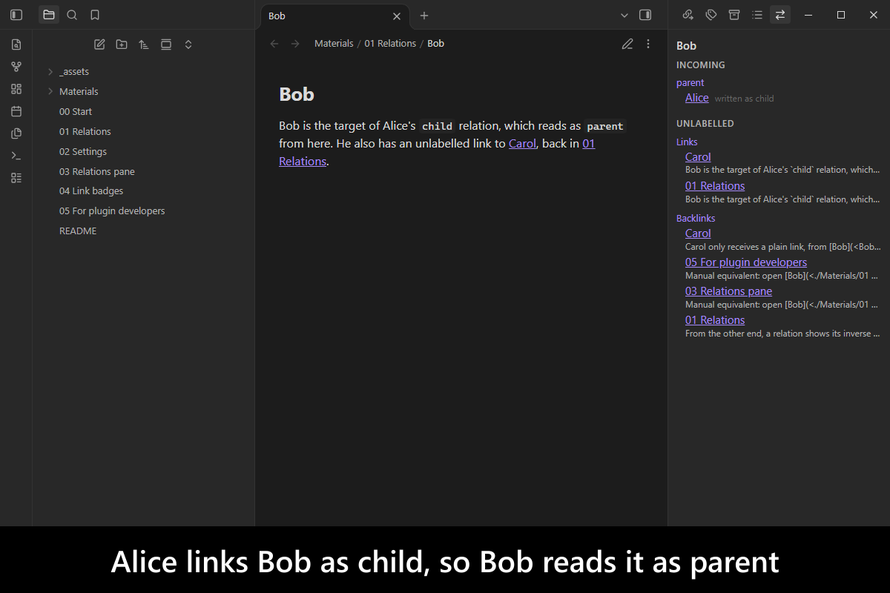
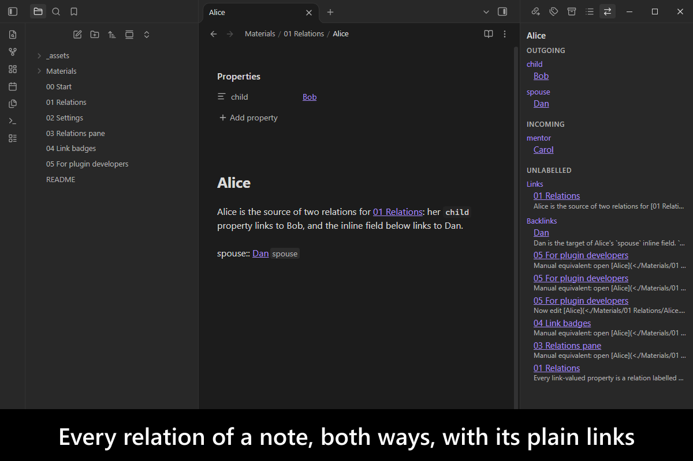
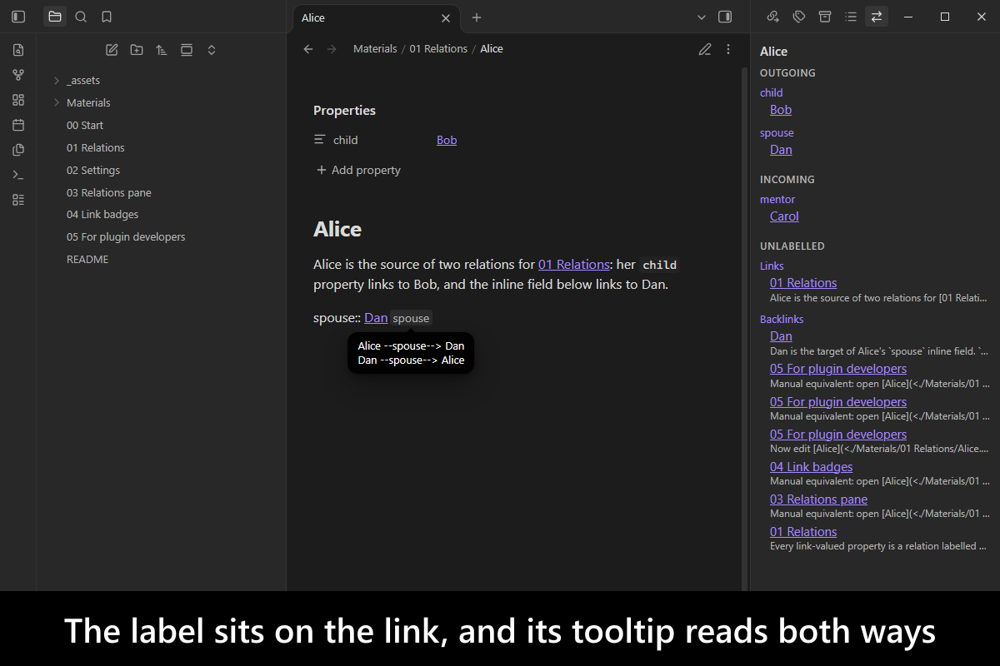
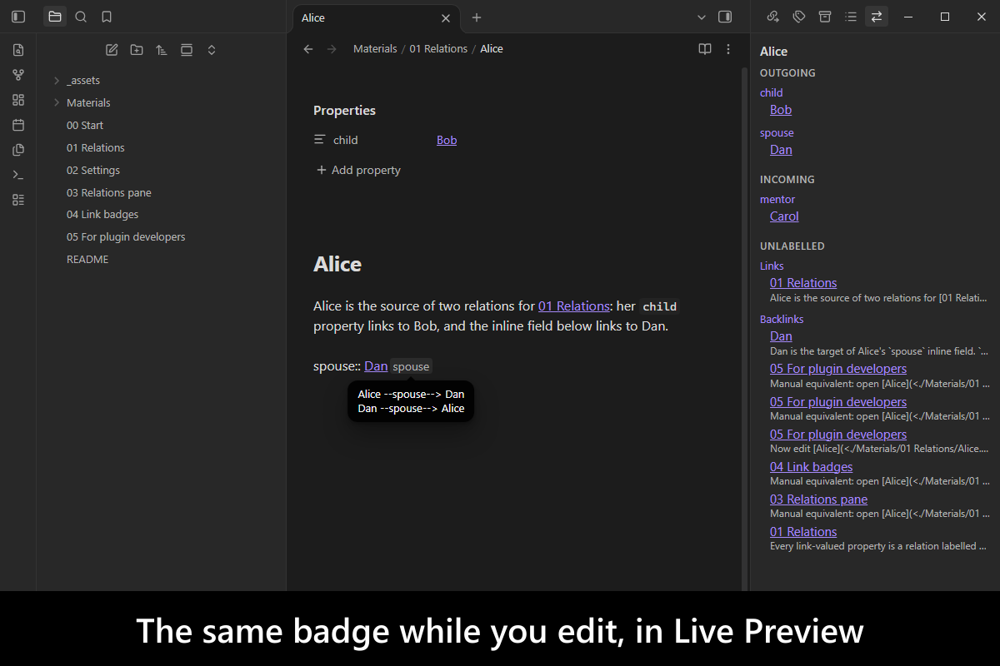
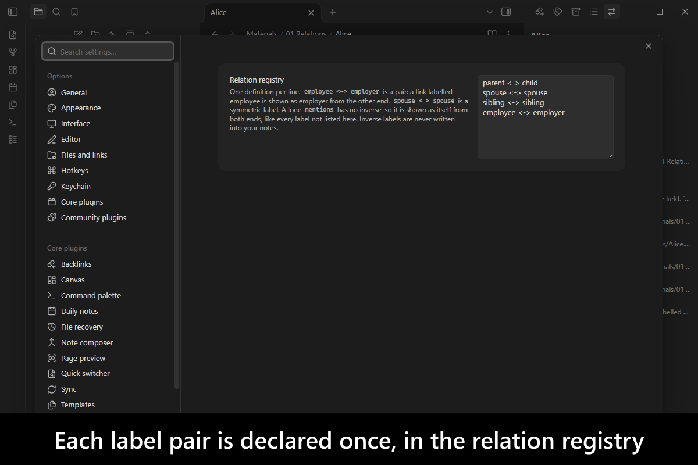
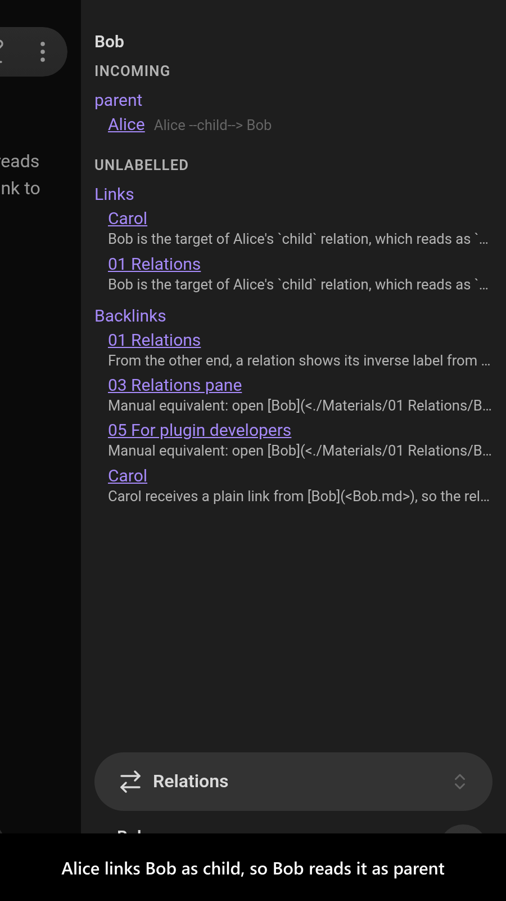
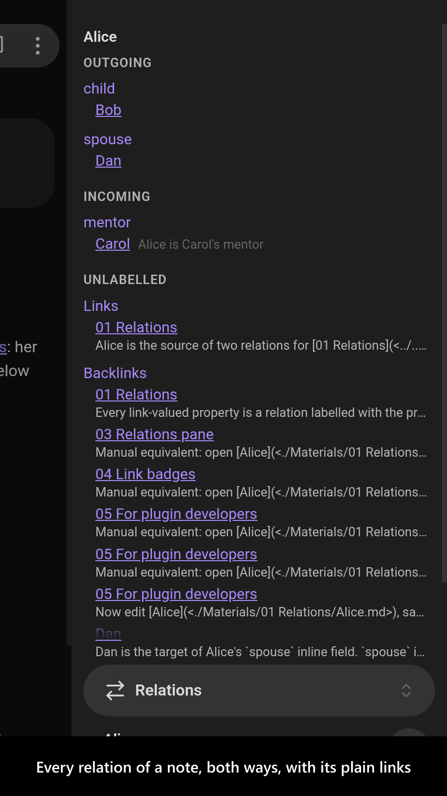
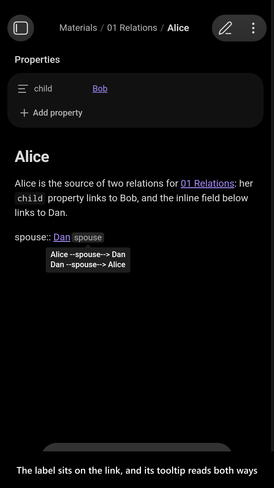
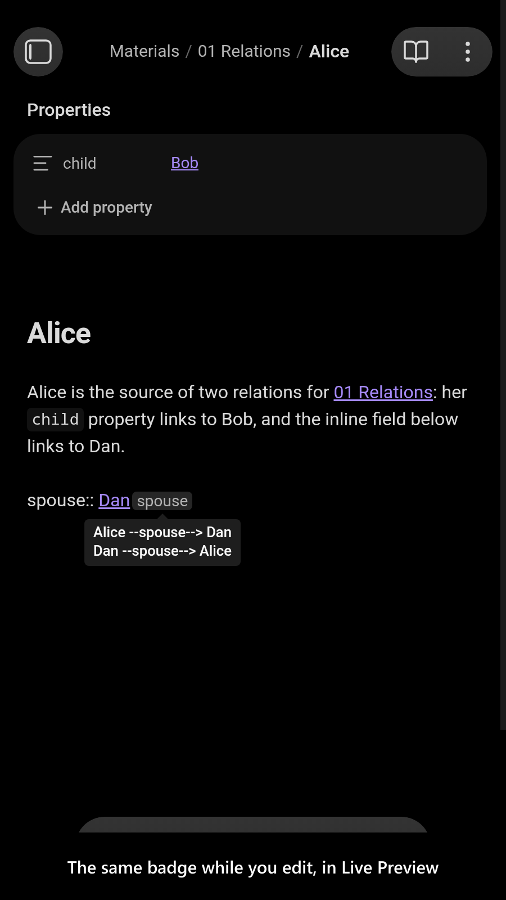
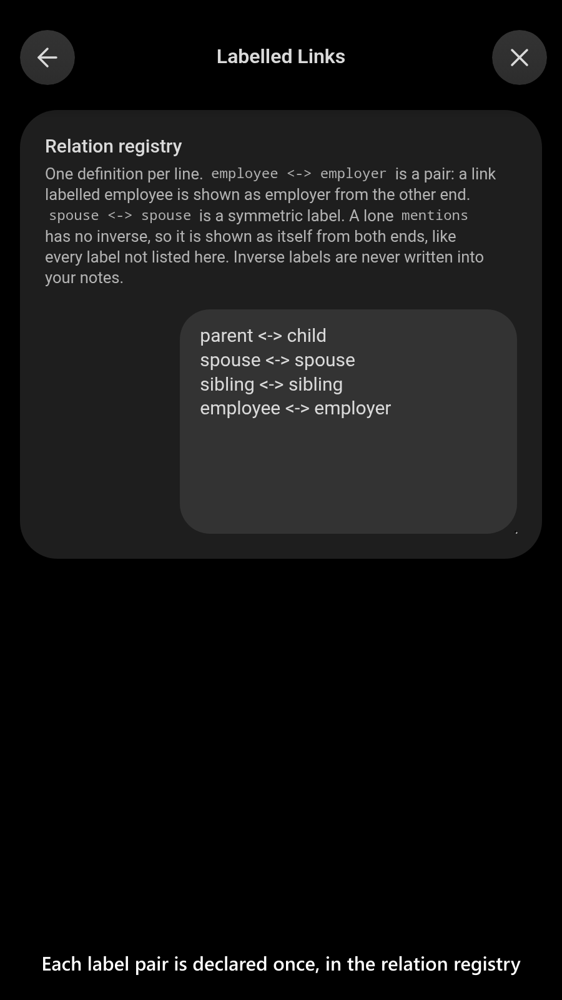

# Labelled Links

   

A link in [Obsidian](https://obsidian.md/) says only that two notes are connected, never how. When `Alice` links to `Bob`, nothing tells you whether Bob is her child, her employer or a book she mentions, and from Bob's end the link is just another backlink. People write the answer down anyway, as `child: "[[Bob]]"` in the properties or `employer:: [[Acme]]` in the text, but the link itself never shows it.

`Labelled Links` reads that syntax as a **labelled relation** and shows the label where you meet the link: as a badge on the link, in a pane listing every relation of a note in both directions, and from the other end under its **inverse** label, so Alice's `child` link reads as `parent` on Bob. You declare each label pair once, in the settings, and nothing is ever written into your notes, so a vault stays readable without the plugin. Other plugins and scripts can query the same relations through a typed API.

It is meant to sit alongside [`Breadcrumbs`](https://community.obsidian.md/plugins/breadcrumbs), not replace it: Breadcrumbs builds hierarchies and their navigation, and this plugin labels the individual links.

<!-- markdownlint-disable MD033 -->

More screenshots

<!-- markdownlint-enable MD033 -->

## Demo vault

**The documentation is an interactive demo vault.** Its notes explain how a link becomes a relation and how each end reads it, with buttons that open the relations pane, show the badges, change the registry and query the API.

**[Start reading here](<./demo-vault/00 Start.md>)** — it is plain markdown, so it works on GitHub with nothing installed.

A copy of the vault ships with every release. You can access it via any of the following:

1. Running the **`Labelled Links`: Open demo vault** command.
2. Downloading `labelled-links-demo-vault.zip` from the [Releases](https://github.com/mnaoumov/obsidian-labelled-links/releases). It unzips into a single `labelled-links-demo-vault-<version>` folder.
3. Browsing its source in [`demo-vault/`](./demo-vault/README.md) in this repository.

## What it does

- **Every link-valued property, and every link in an inline field, is a relation**, labelled by its name, with no setup (`employer:: [[Acme]]`). [01 Relations](<./demo-vault/01 Relations.md>)
- **A relation registry** declares each label pair once (`parent <-> child`), and the inverse is never written into a note. [02 Settings](<./demo-vault/02 Settings.md>)
- **Composition rules** derive the labels nobody should store, for example `aunt = parent -> sibling`. [02 Settings](<./demo-vault/02 Settings.md>)
- **Sub-labels** make one label a kind of another, for example `birthMother < mother`. [02 Settings](<./demo-vault/02 Settings.md>)
- **Label variants** show a label by a property of the note it describes, for example `parent` as `mother` or `father`. [02 Settings](<./demo-vault/02 Settings.md>)
- **Presets** bundle registry lines behind one toggle, for example the bundled **Family** kinship preset. [02 Settings](<./demo-vault/02 Settings.md>)
- **The relations pane** lists every relation of the active note, outgoing, incoming and derived, plus its plain links and backlinks. [03 Relations pane](<./demo-vault/03 Relations pane.md>)
- **A badge on each labelled link** shows its label in Live Preview and Reading view, with a tooltip reading it both ways. [04 Link badges](<./demo-vault/04 Link badges.md>)
- **A typed API and a change event** let other plugins and scripts query a note's relations. [05 For plugin developers](<./demo-vault/05 For plugin developers.md>)

## Similar plugins

- [`Breadcrumbs`](https://community.obsidian.md/plugins/breadcrumbs) — builds typed links from properties, tags, lists, naming schemes, folders and `Dataview` into a hierarchy, with implied inverse relations, a breadcrumb trail, tree and matrix views, previous and next buttons and diagrams; it has no badge on the link itself and no inverse-label sentences, and this plugin leaves hierarchy navigation to it.
- [`Minder Nexus`](https://community.obsidian.md/plugins/minder-nexus) — reads link types from an alias (`[[Note|type]]`) or an inline field, shows type badges in Live Preview and Reading view, groups backlinks by type, and can write the inverse type into the linked note's properties; this plugin never writes an inverse into a note, and adds composition rules, sub-labels and a query API.
- [`Relation Sync`](https://community.obsidian.md/plugins/relation-sync) — writes the inverse of each relation property into the linked note's frontmatter, from declared pairs such as `mother` and `child`, with a preview before it changes anything; this plugin works the inverse out in memory instead.
- [`Nodian`](https://community.obsidian.md/plugins/nodian) — writes a backlink into the matching frontmatter field of the note a field links to, so both notes store the relation.
- [`Relations Suite`](https://community.obsidian.md/plugins/relations-suite) — writes reciprocal relation properties, with built-in family logic and custom pairs, and draws a family tree and a relations graph with the shortest path between two people.
- [`Relate`](https://community.obsidian.md/plugins/relate) — writes two-way relationships into ordinary properties from declared pairs, and adds a connections panel and a search that understands relationships (`children of Atlas`).
- [`Wikilink Types`](https://community.obsidian.md/plugins/wikilink-types) — lets you type `@type` inside a wikilink's alias, with autocomplete, and copies each type into frontmatter for other plugins to read; it shows no inverse.
- [`Graph Link Types`](https://community.obsidian.md/plugins/graph-link-types) — draws the property or inline-field name of a link on its edge in the graph view, through `Dataview`; this plugin labels links in the editor and the pane, not the graph.
- [`Graph Edge Notes`](https://community.obsidian.md/plugins/graph-edge-notes) — draws short relationship labels, kept in a frontmatter list, on graph-view edges, with hover details.
- [`Typed Links`](https://github.com/Querulantenkind/obsidian-typed-links-plugin) (unlisted) — adds a `[[type::Target]]` link syntax, shown as a badge, with a panel of incoming and outgoing typed links and a graph coloured by type; this plugin uses only plain properties and inline fields, so a vault stays readable without it.

Last searched for similar plugins on 2026-10-26.

## For plugin developers

`Labelled Links` publishes a typed API (contract `1.2.0`) and a `labelled-links:relations-changed` event, declared in [`api.d.ts`](./api.d.ts) with its contract in [`api-contract.ts`](./api-contract.ts). How to reach them, every method and the event are in [05 For plugin developers](<./demo-vault/05 For plugin developers.md>).

## Installation

The plugin is available in [the official Community Plugins repository](https://community.obsidian.md/plugins/labelled-links).

### Beta versions

To install the latest beta release of this plugin (regardless if it is available in [the official Community Plugins repository](https://community.obsidian.md) or not), follow these steps:

1. Ensure you have the [BRAT plugin](https://community.obsidian.md/plugins/obsidian42-brat) installed and enabled.
2. Click [Install via BRAT](https://intradeus.github.io/http-protocol-redirector?r=obsidian://brat?plugin=https://github.com/mnaoumov/obsidian-labelled-links).
3. An Obsidian pop-up window should appear. In the window, click the `Add plugin` button once and wait a few seconds for the plugin to install.

## Debugging

By default, debug messages for this plugin (id: `labelled-links`) are hidden.

If you need to enable them refer to the [documentation](https://mnaoumov.dev/obsidian-lib/guides/debugging/).

## Changelog

All notable changes to this project will be documented in the [CHANGELOG](./CHANGELOG.md).

## Contributing

Contributions are welcome — see [CONTRIBUTING](./CONTRIBUTING.md) to get set up.

## Support

<!-- markdownlint-disable MD033 -->

<!-- markdownlint-enable MD033 -->

## My other Obsidian resources

[See my other Obsidian resources](https://github.com/mnaoumov/obsidian-resources).

## License

© [Michael Naumov](https://github.com/mnaoumov/)
